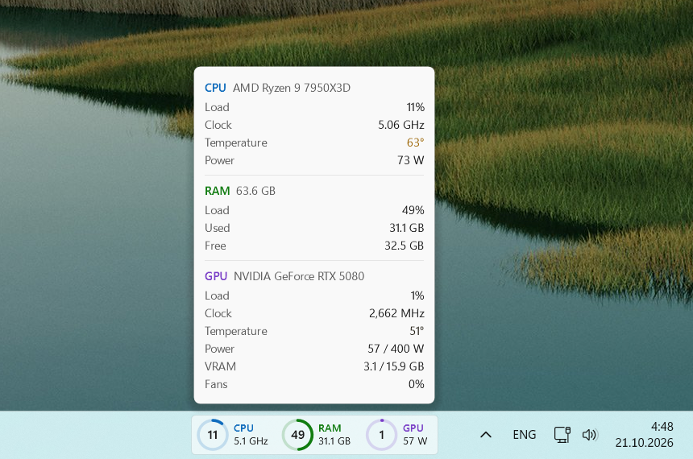

# TaskbarMonitor

[Русская версия](README.ru.md)

A compact CPU, RAM and GPU monitor that sits right on the Windows 11 taskbar, next to the system tray.
Hover over it to see the details.




## Features

- Load rings for CPU, RAM and GPU, updated twice a second. Values are smoothed and the rings move
  continuously, so nothing flickers.
- Under each label — any values you pick in the settings: CPU load, clock, temperature, power; RAM load,
  used, free; GPU load, clock, temperature, power, VRAM, fans.
- Settings window (right-click → Settings…): show, hide and reorder CPU, RAM and GPU, choose their values,
  turn the rings on or off, put items and values in a row or in a column, keep the card on top of other
  windows, hide it in full-screen apps. Changes apply at once.
- Hover card: CPU load, clock, temperature and power; RAM load, used and free; GPU load, clock,
  temperature, power and its limit, VRAM, fans. Temperatures are colored from normal to red.
- Click opens Task Manager. Right-click menu: settings, pin on top (for the card on the screen),
  move back to the tray, start with Windows, exit.
- Drag the panel with the mouse anywhere: along the taskbar, onto the taskbar of another display, or onto
  the screen as a separate card. Near a taskbar it snaps into it. By default the card stays on top of other
  windows and hides while a full-screen app is in front, like the taskbar.
- Light and dark taskbar, any resolution and display scale. English or Russian, following Windows.
- No administrator rights required.

## Requirements

- Windows 11 with the taskbar at the bottom; at first the panel appears on the main display.
- NVIDIA graphics card for GPU data (read from the driver via NVML).
- MSI Afterburner running — only for CPU temperature and power. The CPU temperature and CPU power graphs
  must be enabled in its monitoring settings. Otherwise those fields show “—”.

## Download

Download `TaskbarMonitor.exe` from [Releases](https://github.com/MaybeKrat/TaskbarMonitor/releases/latest)
and run it. It is a single self-contained file: .NET does not need to be installed.

The exe is not signed, so on first launch Windows may show a SmartScreen warning “Windows protected
your PC”. Click “More info” → “Run anyway”.

Settings are stored in `%APPDATA%\TaskbarMonitor\settings.json`, errors are logged to `error.log`
next to the exe.

## Building

Requires the .NET 10 SDK. The release exe is built with:

```powershell
dotnet publish -c Release -r win-x64 --self-contained -p:PublishSingleFile=true -p:IncludeNativeLibrariesForSelfExtract=true -o out
```

The exe is not compressed on purpose: a compressed one is half the size but takes about 40 MB more memory
while running, because .NET unpacks itself into RAM.

`publish.ps1` builds, publishes to a local folder and restarts the running copy — handy while making changes.

## How it works

Windows 11 has no API for taskbar widgets, so the panel is a transparent child window placed inside
the taskbar left of the tray. It is drawn with WPF and shown through a per-pixel-alpha layered window.
When the taskbar icons are aligned left, Windows puts the Widgets button (weather) next to the tray;
the panel then moves left of it. The button has no window of its own, so its position comes from UI Automation.
Dragged off the taskbar, the panel becomes a separate always-on-top window drawn on a card.

| File | What it does |
|---|---|
| `src/Program.cs` | Entry point: single instance, sensor polling every 500 ms, smoothing |
| `src/Sensors.cs`, `src/Afterburner.cs` | Sensors: Windows performance counters, NVML, MSI Afterburner shared memory |
| `src/TaskbarPanel.cs` | The window inside the taskbar: ring animation, hover, click, menu |
| `src/Widgets.cs` | Where the Widgets button is, so the panel does not cover it |
| `src/PanelRenderer.cs` | How the panel looks |
| `src/DetailsFlyout.cs`, `src/DetailsRenderer.cs` | Hover card: the window and how it looks |
| `src/Theme.cs`, `src/Strings.cs` | Light and dark colors, temperature colors; English and Russian texts |
| `src/Settings.cs`, `src/Autostart.cs` | What the panel shows, how and where; start with Windows |
| `src/SettingsWindow.cs` | The settings window |
| `src/Paint.cs`, `src/LayeredCanvas.cs` | Drawing helpers and output to a transparent window |
| `src/Displays.cs` | Displays and their taskbars |
| `src/Native.cs`, `src/Log.cs` | Windows API calls; error log |

Sizes in the renderers are in pixels for a 125% display scale and are recalculated for the actual one.
