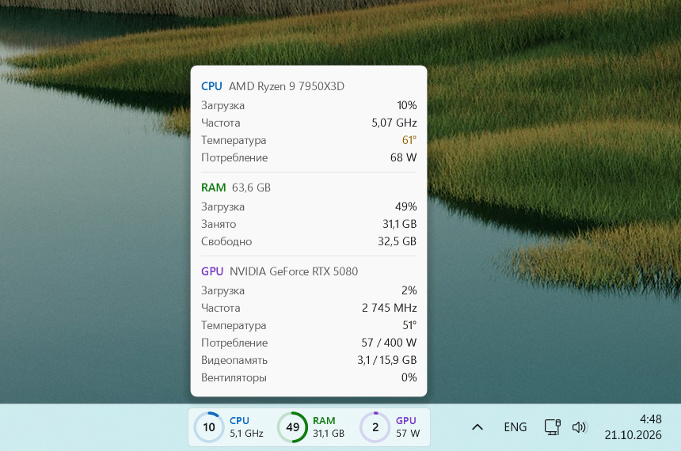

# TaskbarMonitor

[English version](README.md)

Компактный монитор процессора, памяти и видеокарты прямо на панели задач Windows 11, рядом с треем.
При наведении показывает подробности.




## Возможности

- Кольца загрузки CPU, RAM и GPU, обновление дважды в секунду. Цифры сглажены, кольца движутся
  плавно, ничего не мелькает.
- Под каждой подписью — одно значение на выбор в меню по правому клику: частота или температура CPU,
  занятая или свободная память, потребление или температура GPU.
- Карточка при наведении: загрузка, частота, температура и потребление CPU; загрузка, занято и свободно
  у памяти; загрузка, частота, температура, потребление и его лимит, видеопамять и вентиляторы у GPU.
  Температура окрашивается от обычного цвета до красного.
- Клик открывает Диспетчер задач. Меню по правому клику: автозапуск, выбор значений, выход.
- Светлая и тёмная панель задач, любое разрешение и масштаб. Язык — русский или английский, как у Windows.
- Права администратора не нужны.

## Что нужно

- Windows 11, панель задач внизу; панель появляется на основном мониторе.
- Видеокарта NVIDIA — для данных GPU (берутся из драйвера через NVML).
- Запущенный MSI Afterburner — только для температуры и потребления CPU. Без него в этих строках «—».

## Скачать

Скачайте `TaskbarMonitor.exe` в [Releases](https://github.com/MaybeKrat/TaskbarMonitor/releases/latest)
и запустите. Это один самодостаточный файл: .NET устанавливать не нужно.

Настройки хранятся в `%APPDATA%\TaskbarMonitor\settings.json`, ошибки пишутся в `error.log` рядом с exe.

## Сборка

Нужен .NET 10 SDK. Exe для релиза собирается так:

```powershell
dotnet publish -c Release -r win-x64 --self-contained -p:PublishSingleFile=true -p:IncludeNativeLibrariesForSelfExtract=true -o out
```

Exe намеренно не сжат: сжатый вдвое меньше, но во время работы занимает примерно на 40 МБ больше памяти,
потому что .NET распаковывает себя в оперативную память.

`publish.ps1` собирает, публикует в локальную папку и перезапускает работающую копию — удобно при доработке.

## Как устроено

В Windows 11 нет API для виджетов на панели задач, поэтому панель — прозрачное дочернее окно внутри
панели задач слева от трея. Рисуется средствами WPF и выводится через окно с попиксельной прозрачностью.

| Файл | Что делает |
|---|---|
| `src/Program.cs` | Точка входа: один экземпляр, опрос датчиков каждые 500 мс, сглаживание |
| `src/Sensors.cs`, `src/Afterburner.cs` | Датчики: счётчики Windows, NVML, общая память MSI Afterburner |
| `src/TaskbarPanel.cs` | Окно внутри панели задач: анимация колец, наведение, клик, меню |
| `src/PanelRenderer.cs` | Как выглядит панель |
| `src/DetailsFlyout.cs`, `src/DetailsRenderer.cs` | Карточка при наведении: окно и как она выглядит |
| `src/Theme.cs`, `src/Strings.cs` | Цвета светлой и тёмной темы, цвет температуры; тексты на русском и английском |
| `src/Settings.cs`, `src/Autostart.cs` | Настройки из меню и автозапуск |
| `src/Paint.cs`, `src/LayeredCanvas.cs` | Общие приёмы рисования и вывод прозрачного окна |
| `src/Native.cs`, `src/Log.cs` | Вызовы Windows API; журнал ошибок |

Размеры в рендерерах заданы в пикселях для масштаба 125% и пересчитываются под фактический.
